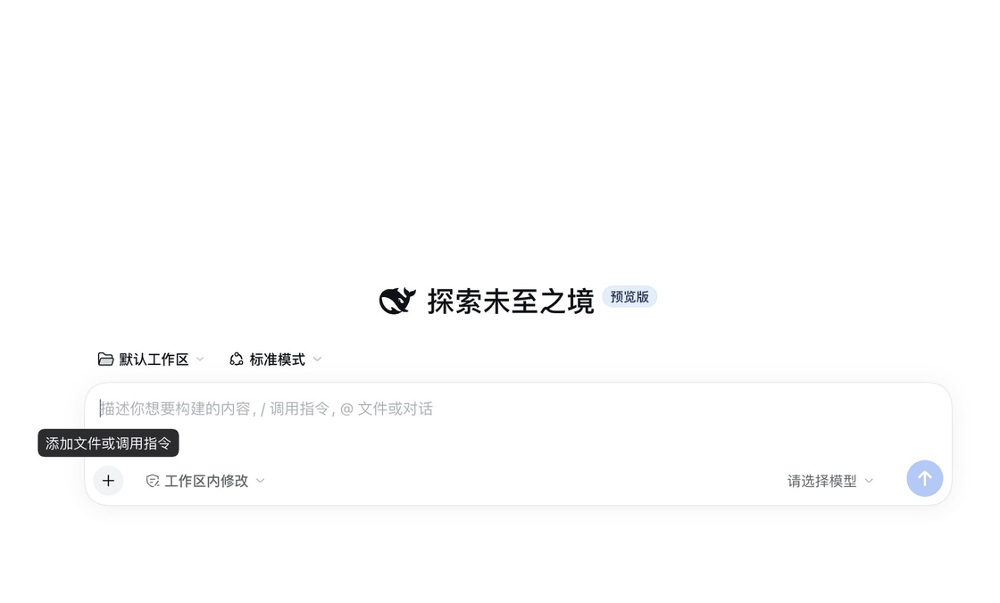

# dsh-chrome-attach

**Attach the current Chrome tab to your conversation.** One pick in the composer screenshots the page you are looking at, drops it into the draft as an image attachment, and types the tab's **title and URL** on a line next to it — the same move as ChatGPT's *+ → attach browser page*, except the model also learns *which* page it is looking at. Everything waits in the draft; nothing is sent until you press Enter.

[简体中文](README.zh-CN.md) · a DeepSeek Harness plugin

[](https://www.npmjs.com/package/dsh-chrome-attach)
[](https://github.com/deqingLv/dsh-chrome-attach/releases)
[](LICENSE)



The plugin tries three capture tiers in order and uses the first one that works. **No bridge, no extension and no Chrome flags are required** — only the image quality differs:

| Tier | What the image contains | Needs | Notes |
|---|---|---|---|
| `bridge` | tab content only | `dsh-chrome-bridge` + the DSH Bridge extension | best: no focus stealing, no prompt, supports full-page |
| `cdp` | tab content only | Chrome's own **Remote debugging** switch | one approval, keeps your normal profile |
| `window` | the whole Chrome window (**including** tab strip and address bar) | macOS + Screen Recording permission | no extension; briefly raises Chrome to the front |

The default chain is `bridge → cdp → window`; the first tier that succeeds wins. Every response names its `source`, and a window shot is labelled *"window shot, browser UI included"*.

## Install

Needs a DSH build that ships `commandUi` and the session-slot `inputActions` prop (that is what writes the page line). On older builds the screenshot still attaches; only the line is skipped, and the toast says so.

### From npm

```sh
dsh plugin --profile desktop add dsh-chrome-attach   # "web" for the web profile
```

Then refresh the window (`Cmd+R`) or restart DSH — new bundles are not hot-loaded.

### From a release tarball

1. Download `dsh-chrome-attach-<version>.tgz` from [Releases](https://github.com/deqingLv/dsh-chrome-attach/releases).
2. In DSH open **Plugins → Add plugin** and paste the tarball's absolute path.
3. Refresh the window (`Cmd+R`) or restart DSH — new bundles are not hot-loaded.

### From source

```sh
git clone https://github.com/deqingLv/dsh-chrome-attach.git
```

Add the plugin by its absolute **directory** path. It installs as a `link:`, so edits to the code take effect after a restart:

```
/Users/you/WorkSpace/Github/dsh-chrome-attach
```

## Use

The `+` menu in the composer gains one row, right below *Add files* in the Add section:

> **[Chrome mark] Attach Chrome** · *Screenshot the page, plus its title and URL*

Clicking it screenshots the active tab (or degrades to the window), puts the image into the current draft, writes the page line, and **does not send**. Keep typing. `/attach` works too.

An image only tells the model what the pixels look like, not which page it came from, so the row also inserts one line through the composer's own input facade:

```
Chrome tab: Kaboo — https://kaboo.bytedance.net/?section=team
```

That line and the image are one draft: it is plain text you can edit or delete, and both leave together when you press Enter. If the draft is mid-send or no editable draft is attached, only the image lands and the toast says the page line was skipped (`已附上（页面地址未能写入输入框）：…`).

Attachment names carry the page title, e.g. `DeepSeek-Harness-155812.png`.

Full-page capture exists in the API (`POST /api/chrome-attach/shot {"full":true}`) but is not a separate menu row yet.

## Capture setups

### 1. `bridge` — no permissions at all

Install `dsh-chrome-bridge` from the DSH plugin page and the **DSH Bridge** extension in Chrome, then connect once. The plugin shells out to the `cb` CLI (`~/.dsh/bin/cb`) and gets the bare tab content, without stealing focus.

### 2. `cdp` — Chrome's own Remote debugging switch

The clean-tab fallback that needs no extension and no Screen Recording. Chrome 136 changed `--remote-debugging-port`, but Chrome now ships a supported switch instead:

1. Open `chrome://inspect/#remote-debugging` and tick **Remote debugging**.
2. Click **Attach Chrome** in DSH; the first connection asks once whether to allow the app — allow it.
3. Chrome writes the chosen port to `<profile>/DevToolsActivePort`, and the plugin reads it. Your profile, logins and extensions stay exactly as they are.

The switch is governed by the `DevToolsRemoteDebuggingAllowed` policy. On a managed machine where it is disabled the checkbox is greyed out — use the `window` tier or `bridge` instead.

Already launching Chrome with a debug port? The plugin also probes `9222`/`9223` and any port named by `DSH_CHROME_DEBUG_PORT`:

```sh
"/Applications/Google Chrome.app/Contents/MacOS/Google Chrome" \
  --remote-debugging-port=9222 \
  --user-data-dir="$HOME/.chrome-dsh-debug"
```

### 3. `window` — macOS screen recording

Nothing to install inside Chrome; DSH needs Screen Recording once:

1. System Settings → Privacy & Security → **Screen Recording** → enable **DeepSeek Harness**.
2. Quit and reopen DSH (macOS requires a process restart for permission changes).
3. Pick **Attach Chrome page** from the `+` menu. The shot is the whole Chrome window.

Window shots are downscaled to a 2200px long edge (about 1 MB on Retina, still readable). If another window covers Chrome, the plugin raises Chrome for the capture and switches back to DSH (roughly a second of focus switching). Google Chrome only.

## How it works

```
browser (client/client.js)
  └─ menu row → POST /api/chrome-attach/shot {full}
        └─ host (lib/index.js → lib/capture.js)
              ├─ bridge: cb shot active --out … --json
              ├─ cdp:    /json/version → WebSocket → Page.captureScreenshot
              └─ window: Chrome AppleScript bounds → screencapture -R
        ← { dataUrl, title, url, source, degraded }
  └─ dataUrl → File → synthetic drop → DSH's image intake → draft
  └─ title + url → inputActions.insertText → same draft, one line
```

The host half only imports Node built-ins, so it never depends on packages the DSH profile may not resolve. The client half is the entry in the `+` menu; it hands the PNG to the same attachment intake a real drag-and-drop uses. The page line goes through `inputActions`, the façade the conversation publishes to session slots as a prop — the plugin registers one headless `conversation.input.dock` entry to hold on to it, so it never reaches into the session directly and inherits the façade's phase/revision guards.

## Configuration

| Variable | Default | Meaning |
|---|---|---|
| `DSH_CHROME_ATTACH_MODE` | `auto` | Pin one tier: `bridge`, `cdp`, `window` |
| `DSH_CHROME_DEBUG_PORT` | — | Extra CDP port to probe |
| `DSH_CHROME_BRIDGE_CB` | — | Explicit path to the `cb` CLI |
| `DSH_OSASCRIPT_BIN` / `DSH_SCREENCAPTURE_BIN` | system paths | Overrides for testing |

## Limitations

- Captures only the **active tab** (`bridge`/`cdp`) or the **frontmost Chrome window** (`window`).
- The page line is typed into the focused draft, so it needs an editable composer; while a message is being sent the image attaches but the line is skipped (the toast says so).
- A `window` shot's URL/title come from the same page, so they describe the frontmost tab rather than the whole window.
- `chrome://` pages and the Chrome Web Store cannot be captured through `chrome.debugger`; the `window` tier is unaffected.
- The `window` tier needs Screen Recording; failures point at the exact System Settings pane.
- Images travel over a loopback route and are never uploaded; they end up as a normal DSH attachment.

## Development

```sh
npm run check
```

Probe a single tier:

```sh
DSH_CHROME_ATTACH_MODE=window node -e "import('./lib/capture.js').then(m => m.capturePage())"
DSH_CHROME_DEBUG_PORT=9222 node -e "import('./lib/capture.js').then(m => m.capturePage({mode:'cdp'}))"
DSH_CHROME_BRIDGE_CB=/path/to/fake-cb node -e "import('./lib/capture.js').then(m => m.capturePage({mode:'bridge'}))"
```

## License

[MIT](LICENSE)
